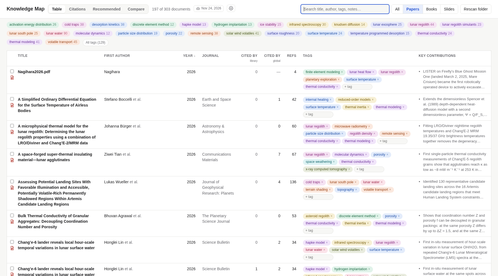
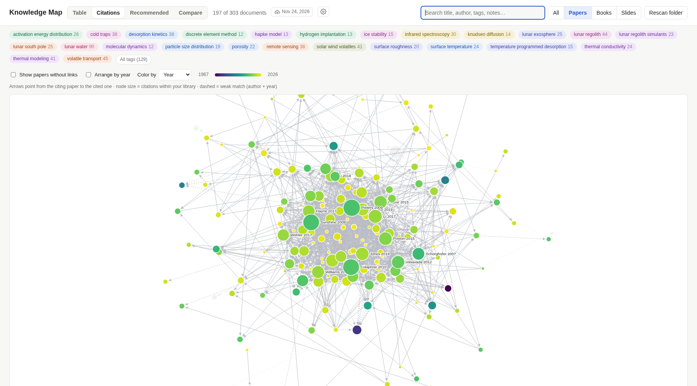
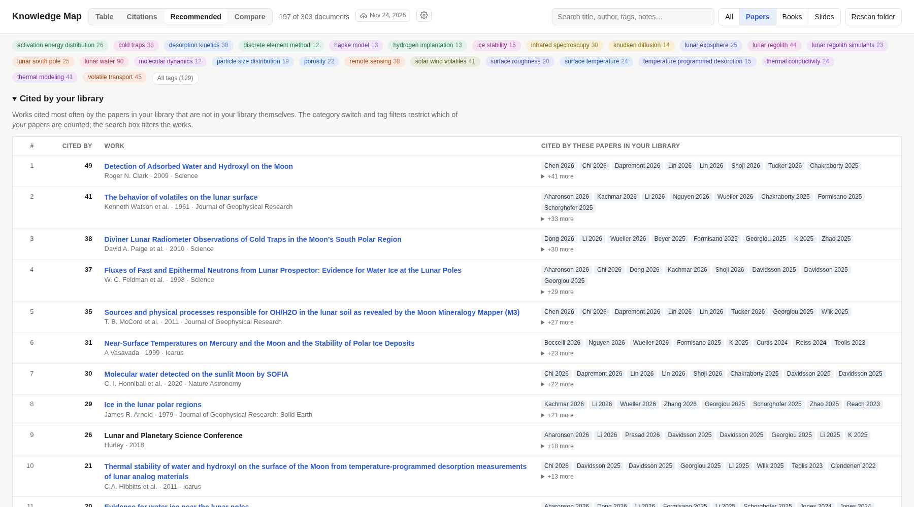

# Knowledge Map

A local web app for your folder of scientific PDFs. Point it at the folder and it builds a searchable
library: metadata looked up automatically, your tags and notes, a graph of which papers cite which, and
reading recommendations. Everything runs on your machine and is stored in a local SQLite database.

## Features

- **Table** of all PDFs with title, authors, year, journal and citation counts, filled in from the PDF,
  Crossref and OpenAlex (and a BibTeX file in the folder, if there is one). Search, sort, filter by tag,
  add tags and notes, open the PDF. Keyboard friendly: `Ctrl+F`, arrows, `Enter` for details, `p` for the PDF.
- **Claude analysis** (optional): key contributions, methodology and tags for each paper, generated by your
  local [Claude Code](https://claude.com/claude-code) CLI. Tags reuse your existing vocabulary.
- **Citation graph** of how the papers in your library cite each other.
- **Recommendations**: works not in your library that many of your papers cite, and works that cite many
  of your papers (updated daily).
- **Compare** two or more papers to see the references they share.
- **Downloads watcher** (optional): new article PDFs in your downloads folder are offered for adding to the
  library, renamed to `AuthorYear-Title.pdf`.
- **Daily backup** (optional) of the PDFs and the database to another folder, such as a mounted network
  share. Nothing is ever deleted from the backup.

Subfolders named `books` and `slides` are listed separately as books and slides.

## Install

Requirements: Python 3.11+, [uv](https://docs.astral.sh/uv/), `pdftotext` (poppler) and `rsync`.
For the Claude analysis, the [Claude Code CLI](https://claude.com/claude-code) installed and logged in.

```bash
git clone https://github.com/atmarc/knowledge_map.git
cd knowledge_map
./run.sh
```

Open http://127.0.0.1:8765. On first start the Settings panel opens: enter the folder that holds your
PDFs, and the library is built in the background.

### Run in the background (Linux)

```bash
scripts/install-service.sh                 # systemd user service, started at login
loginctl enable-linger $USER               # optional: start at boot without logging in
systemctl --user status knowledge-map      # also: restart, stop
```

## Settings

All settings are in the Settings panel (gear icon) and saved to `data/config.json`:

| Setting | Purpose |
|---|---|
| Literature folder | The folder with your PDFs (required) |
| Watch for downloaded articles | Folder to watch, e.g. `~/Downloads`; empty to turn it off |
| Backup folder | Where daily backups go; empty to turn them off |
| Research field | Tells Claude what your library is about |
| Claude model | e.g. `sonnet` or `opus`; empty for Claude Code's default |
| OpenAlex API key | Optional, [free](https://openalex.org/settings/api); without one OpenAlex allows ~1000 requests a day per IP address |

## Backups

Set a *Backup folder* in Settings to turn backups on. It can be any folder, typically a mounted network
share or an external drive. Knowledge Map never mounts anything itself.

- **When:** once a day, at the first check after the chosen hour (12:00 by default). The cloud icon in the
  header shows the date of the last backup; click it to back up now.
- **What:** PDFs missing from the backup folder are copied, and PDFs changed locally replace their older copy.
  A snapshot of the database is saved to `knowledge_map/library.db` in the backup folder.
- **Never deleted:** files removed from your library stay in the backup, and files that are newer in the
  backup folder are left alone.
- **When the folder isn't available** (e.g. the share isn't mounted), that day's backup is skipped and the
  icon turns orange; hover over it to see why. The next day, or a click, tries again.

## Privacy

Your PDFs never leave your machine, except for the text sent to Claude when you run an analysis, which
uses your own Claude account. Metadata lookups send DOIs and titles to Crossref and OpenAlex. The
downloads watcher only looks up DOIs printed in PDFs, so documents without one cause no network traffic.

## Data

Everything is stored in `data/`: `library.db` (papers, tags, notes, citations) and `config.json`. To restore
a backup, stop the app and copy `knowledge_map/library.db` from the backup folder to `data/library.db`.

## License

[MIT](LICENSE)

## Screenshots

**Table**: metadata, tags and key contributions for each paper.



**Citations**: which papers in the library cite which.



**Recommended**: works your papers cite most that aren't in your library yet.


